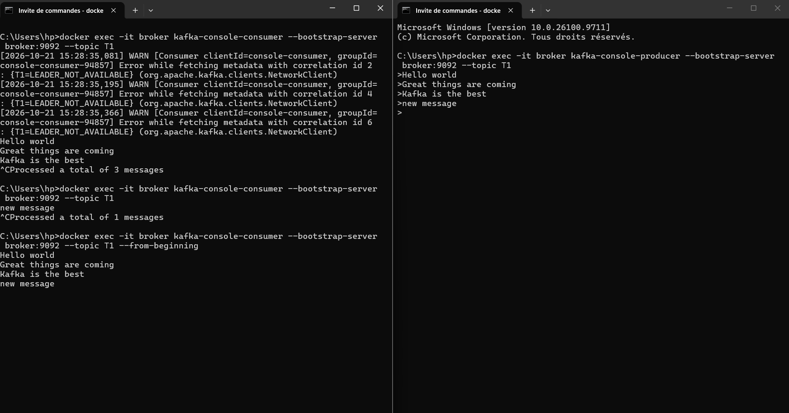
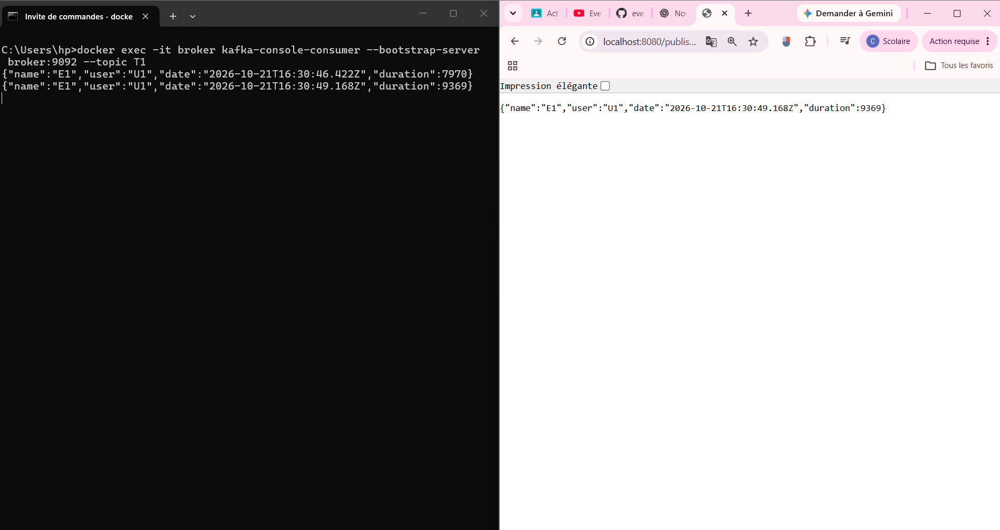
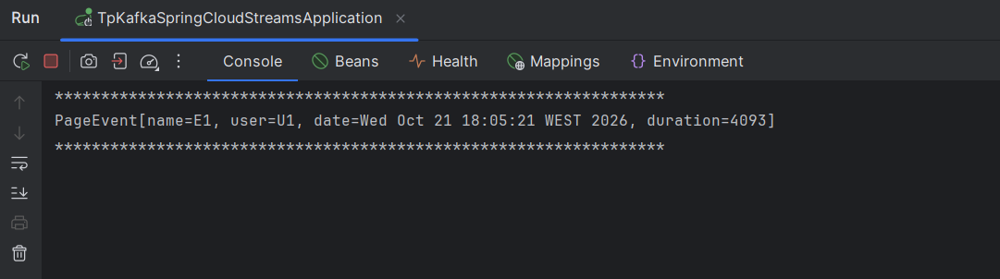
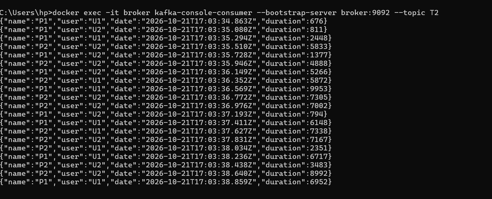
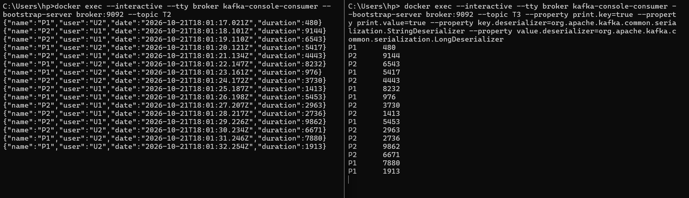
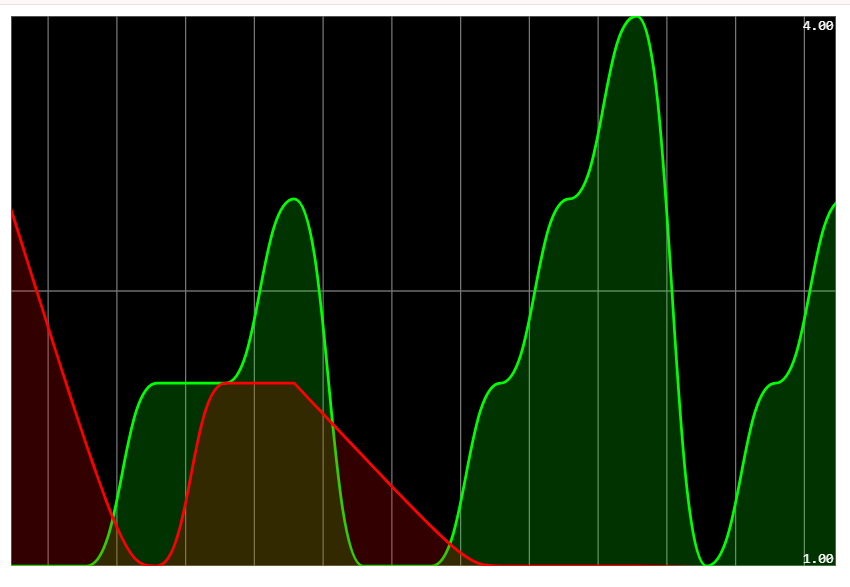

<div align="center">

# Architecture Événementielle & Real-Time Stream Analytics
### Apache Kafka, Spring Cloud Streams & Kafka Streams

[](#)
[](#)
[](#)
[](#)
[](#)

<p align="center">
  <b>Systèmes Distribués & DevOps</b> — Conception et implémentation d'une chaîne complète de traitement d'événements : de la publication asynchrone au calcul fenêtré temps réel et à la restitution graphique par Server-Sent Events (SSE).
</p>

</div>

---

## Sommaire

1. [Vue d'Ensemble & Architecture Globale](#1-vue-densemble--architecture-globale)
2. [Structure du Projet](#2-structure-du-projet)
3. [Infrastructure Kafka & Zookeeper (Docker)](#3-infrastructure-kafka--zookeeper-docker)
4. [Service Producer REST avec StreamBridge](#4-service-producer-rest-avec-streambridge)
5. [Service Consumer avec Spring Cloud Stream](#5-service-consumer-avec-spring-cloud-stream)
6. [Service Supplier (Génération Continue d'Événements)](#6-service-supplier-génération-continue-dévénements)
7. [Traitement de Flux Temps Réel avec Kafka Streams](#7-traitement-de-flux-temps-réel-avec-kafka-streams)
8. [Interactive Queries, Flux SSE & Dashboard Temps Réel](#8-interactive-queries-flux-sse--dashboard-temps-réel)
9. [Configuration Applicative](#9-configuration-applicative)
10. [Guide d'Installation & Démarrage](#10-guide-dinstallation--démarrage)

---

## 1. Vue d'Ensemble & Architecture Globale

Ce projet implémente une architecture pilotée par les événements (**Event-Driven Architecture - EDA**) en tirant parti du modèle de programmation fonctionnel de **Spring Cloud Stream** et du moteur de traitement de flux distribué **Kafka Streams**.

### Flux de données et composants du système

Le système s'articule autour de trois canaux de traitement :

1. **Canal Transactionnel (T1)** : Publication ponctuelle d'événements de navigation (`PageEvent`) via une API REST (`StreamBridge`), puis consommation unitaire et asynchrone par un consommateur Spring Cloud.
2. **Canal Continu & Fenêtrage (T2 $\rightarrow$ T3)** : Génération périodique (1 seconde) d'événements dans le topic `T2` par un `Supplier`. Un pipeline **Kafka Streams** consomme ces données, applique un groupage par page (`P1`, `P2`), effectue une agrégation par **fenêtre glissante de 5 secondes** (`TimeWindows`), maintient un état local persistant (`count-store`) et publie les résultats agrégés vers le topic `T3`.
3. **Canal de Restitution Interactive & SSE** : Un contrôleur réactif interroge le `ReadOnlyWindowStore` de Kafka Streams via `InteractiveQueryService` et pousse chaque seconde les métriques vers le navigateur via un flux **Server-Sent Events (`/analytics`)**, matérialisé par un tableau de bord graphique temps réel (Smoothie Charts).

```mermaid
flowchart LR
    subgraph Clients["Clients & UI"]
        Browser["Navigateur / API"]
        Dashboard["Dashboard Smoothie Charts (index.html)"]
    end

    subgraph SpringApp["Application Spring Boot"]
        direction TB
        RestController["PageEventController<br/>(StreamBridge)"]
        ConsumerService["pageEventConsumer<br/>(Consumer&lt;PageEvent&gt;)"]
        SupplierService["pageEventSupplier<br/>(Supplier&lt;PageEvent&gt;)"]
        KStreams["kStreamFunction<br/>(Kafka Streams Windowed Count)"]
        StateStore[("State Store Local<br/>count-store")]
        SSE["Endpoint SSE /analytics<br/>(InteractiveQueryService)"]
    end

    subgraph KafkaCluster["Cluster Apache Kafka (Docker)"]
        T1[("Topic T1")]
        T2[("Topic T2")]
        T3[("Topic T3")]
    end

    %% Flux 1 : REST vers T1 vers Consumer
    Browser -->|GET /publish?name=...&topic=T1| RestController
    RestController -->|StreamBridge.send| T1
    T1 -->|pageEventConsumer-in-0| ConsumerService

    %% Flux 2 : Supplier vers T2 vers Kafka Streams vers T3
    SupplierService -->|pageEventSupplier-out-0 (1s)| T2
    T2 -->|kStreamFunction-in-0| KStreams
    KStreams -->|State update| StateStore
    KStreams -->|kStreamFunction-out-0| T3

    %% Flux 3 : SSE Dashboard
    StateStore -->|Interactive Queries| SSE
    SSE -->|text/event-stream| Dashboard
```

---

## 2. Structure du Projet

```text
tp-kafka-spring-cloud-streams/
├── docker-compose.yml              # Cluster Kafka (Broker + Zookeeper)
├── pom.xml                         # Dépendances Spring Boot, Cloud Stream & Kafka Streams
├── screenshots/                    # Captures d'écran des tests et validations
└── src/
    ├── main/
    │   ├── java/net/zoungrana/tpkafkaspringcloudstreams/
    │   │   ├── TpKafkaSpringCloudStreamsApplication.java
    │   │   ├── controllers/
    │   │   │   └── PageEventController.java      # REST Producer + Endpoint SSE /analytics
    │   │   ├── events/
    │   │   │   └── PageEvent.java                # Modèle de données (Record)
    │   │   └── handlers/
    │   │       └── PageEventHandler.java        # Fonctions Consumer, Supplier & KStream
    │   └── resources/
    │       ├── application.properties            # Bindings Spring Cloud Stream & config Kafka
    │       └── static/
    │           └── index.html                    # Dashboard temps réel Smoothie.js
    └── test/
```

---

## 3. Infrastructure Kafka & Zookeeper (Docker)

Le déploiement local de l'infrastructure de messagerie s'appuie sur les images officielles Confluent (`cp-zookeeper` et `cp-kafka` en version 7.3.0).

### Définition du fichier `docker-compose.yml`

```yaml
services:
  zookeeper:
    image: confluentinc/cp-zookeeper:7.3.0
    container_name: zookeeper
    environment:
      ZOOKEEPER_CLIENT_PORT: 2181
      ZOOKEEPER_TICK_TIME: 2000

  broker:
    image: confluentinc/cp-kafka:7.3.0
    container_name: broker
    ports:
      - "9092:9092"
    depends_on:
      - zookeeper
    environment:
      KAFKA_BROKER_ID: 1
      KAFKA_ZOOKEEPER_CONNECT: 'zookeeper:2181'
      KAFKA_LISTENER_SECURITY_PROTOCOL_MAP: PLAINTEXT:PLAINTEXT,PLAINTEXT_INTERNAL:PLAINTEXT
      KAFKA_ADVERTISED_LISTENERS: PLAINTEXT://localhost:9092,PLAINTEXT_INTERNAL://broker:29092
      KAFKA_OFFSETS_TOPIC_REPLICATION_FACTOR: 1
      KAFKA_TRANSACTION_STATE_LOG_MIN_ISR: 1
      KAFKA_TRANSACTION_STATE_LOG_REPLICATION_FACTOR: 1
```

### Validation avec la CLI Kafka

Après démarrage des conteneurs (`docker compose up -d`), la communication a été validée à l'aide des utilitaires natifs en ligne de commande :
- **Producteur console** : écriture manuelle de messages sur le topic test.
- **Consommateur console** : lecture en streaming avec le flag `--from-beginning`.

```bash
# Lancement d'un producteur console
docker exec -it broker kafka-console-producer --bootstrap-server localhost:9092 --topic test-topic

# Lancement d'un consommateur console
docker exec -it broker kafka-console-consumer --bootstrap-server localhost:9092 --topic test-topic --from-beginning
```

<div align="center">
  
  <p><em>Figure 1 : Validation de l'échange de messages entre <code>kafka-console-producer</code> et <code>kafka-console-consumer</code> au sein du broker Docker.</em></p>
</div>

---

## 4. Service Producer REST avec StreamBridge

Plutôt que d'utiliser directement `KafkaTemplate`, le service s'appuie sur `StreamBridge` de Spring Cloud Stream, ce qui garantit un découplage total vis-à-vis du broker sous-jacent.

### Modèle de données : `PageEvent`

Le payload d'événement est modélisé sous la forme d'un Java Record immuable :

```java
package net.zoungrana.tpkafkaspringcloudstreams.events;

import java.util.Date;

public record PageEvent(String name, String user, Date date, long duration) {
}
```

### Contrôleur de publication : `PageEventController`

L'endpoint `/publish` instancie dynamiquement un événement avec des valeurs aléatoires pour l'utilisateur (`U1`, `U2`) et la durée de visite, puis l'envoie sur le topic spécifié en paramètre de requête.

```java
@GetMapping("/publish")
public PageEvent publish(@RequestParam(name="name") String name, @RequestParam(name="topic") String topic) {
    PageEvent pageEvent = new PageEvent(
            name,
            Math.random() > 0.5 ? "U1" : "U2",
            new Date(),
            10 + new Random().nextInt(10000)
    );

    streamBridge.send(topic, pageEvent);
    return pageEvent;
}
```

### Validation de la production via navigateur

En émettant une requête HTTP GET vers `http://localhost:8080/publish?name=P1&topic=T1`, l'objet JSON sérialisé est transmis instantanément au broker et réceptionné par le consommateur console à l'écoute sur le topic `T1`.

<div align="center">
  
  <p><em>Figure 2 : Publication d'un événement via l'endpoint REST du navigateur et vérification de la réception dans <code>kafka-console-consumer</code>.</em></p>
</div>

---

## 5. Service Consumer avec Spring Cloud Stream

L'approche fonctionnelle de Spring Cloud Stream traite les consommateurs comme de simples beans implémentant l'interface fonctionnelle standard `java.util.function.Consumer<T>`.

### Implémentation du bean Consumer

```java
@Bean
public Consumer<PageEvent> pageEventConsumer() {
    return (input) -> {
        System.out.println("******************************************************************");
        System.out.println(input.toString());
        System.out.println("******************************************************************");
    };
}
```

### Liaison avec le topic (`application.properties`)

```properties
spring.cloud.stream.bindings.pageEventConsumer-in-0.destination=T1
spring.cloud.function.definition=pageEventConsumer;pageEventSupplier;kStreamFunction
```

Chaque message publié dans le topic `T1` est désérialisé automatiquement en instance de `PageEvent` et affiché sur la sortie standard de l'application.

<div align="center">
  
  <p><em>Figure 3 : Trace d'exécution démontrant la consommation asynchrone des messages du topic T1 par le bean <code>pageEventConsumer</code>.</em></p>
</div>

---

## 6. Service Supplier (Génération Continue d'Événements)

Pour simuler un flux continu de trafic web sans intervention manuelle, un bean `Supplier<PageEvent>` est déclaré. Spring Cloud Stream l'interroge de façon répétée via un mécanisme de polling périodique.

### Implémentation du bean Supplier

```java
@Bean
public Supplier<PageEvent> pageEventSupplier() {
    return () -> new PageEvent(
            Math.random() > 0.5 ? "P1" : "P2",
            Math.random() > 0.5 ? "U1" : "U2",
            new Date(),
            10 + new Random().nextInt(10000)
    );
}
```

### Paramétrage du polling et destination

Le binding de sortie est configuré pour publier chaque seconde (`fixed-delay=1000`) vers le topic `T2` :

```properties
spring.cloud.stream.bindings.pageEventSupplier-out-0.destination=T2
spring.cloud.stream.bindings.pageEventSupplier-out-0.producer.poller.fixed-delay=1000
```

<div align="center">
  
  <p><em>Figure 4 : Inspection des événements sérialisés au format JSON générés automatiquement dans le topic T2 par <code>pageEventSupplier</code>.</em></p>
</div>

---

## 7. Traitement de Flux Temps Réel avec Kafka Streams

Le cœur du calcul analytique repose sur **Kafka Streams**, via un bean de type `java.util.function.Function<KStream<K, V>, KStream<K2, V2>>`.

### Logique de transformation et fenêtrage

L'algorithme de streaming applique la chaîne de traitement suivante :
1. **Extraction de clé / valeur** : projection de la paire `(pageName, duration)`.
2. **Regroupement par clé** : partitionnement par nom de page (`P1`, `P2`) avec les Serdes appropriés (`Serdes.String()`, `Serdes.Long()`).
3. **Fenêtrage temporel sans tolérance** : définition de fenêtres rectangulaires tumbling de **5 secondes** (`TimeWindows.ofSizeWithNoGrace(Duration.ofSeconds(5))`).
4. **Comptage et persistance d'état** : calcul du volume de requêtes par fenêtre et stockage dans la table d'état locale matérialisée `"count-store"`.
5. **Émission vers l'aval** : conversion en flux régulier et transmission vers le topic de sortie `T3`.

```java
@Bean
public Function<KStream<String, PageEvent>, KStream<String, Long>> kStreamFunction() {
    return (input) -> input
            .map((key, value) -> new KeyValue<>(value.name(), value.duration()))
            .groupByKey(Grouped.with(Serdes.String(), Serdes.Long()))
            .windowedBy(TimeWindows.ofSizeWithNoGrace(Duration.ofSeconds(5)))
            .count(Materialized.as("count-store"))
            .toStream()
            .map((k, v) -> new KeyValue<>(k.key(), v));
}
```

### Configuration des liaisons Kafka Streams

```properties
spring.cloud.stream.bindings.kStreamFunction-in-0.destination=T2
spring.cloud.stream.bindings.kStreamFunction-out-0.destination=T3
spring.cloud.stream.kafka.streams.binder.configuration.commit.interval.ms=1000
```

### Observation simultanée des flux T2 et T3

La capture ci-dessous illustre la corrélation directe entre le flux brut entrant sur `T2` (produit par `pageEventSupplier`) et le flux de métriques agrégées émis sur `T3` par `kStreamFunction`.

<div align="center">
  
  <p><em>Figure 5 : Données brutes consommées depuis T2 (gauche/haut) et résultats calculés par fenêtre de 5 secondes publiés dans T3 (droite/bas).</em></p>
</div>

---

## 8. Interactive Queries, Flux SSE & Dashboard Temps Réel

Plutôt que d'interroger une base de données relationnelle externe, l'application utilise les **Interactive Queries** de Kafka Streams pour lire directement l'état agrégé dans le state store local (`count-store`).

### Endpoint réactif Server-Sent Events (SSE)

Le contrôleur utilise `InteractiveQueryService` pour sonder le `ReadOnlyWindowStore` sur un intervalle glissant de 5 secondes (`Instant.now().minusMillis(5000)` à `Instant.now()`). Le résultat est diffusé à cadence d'une seconde sous forme de flux réactif (`Flux<Map<String, Long>>`) au format `text/event-stream`.

```java
@GetMapping(path = "/analytics", produces = MediaType.TEXT_EVENT_STREAM_VALUE)
public Flux<Map<String, Long>> analytics() {
    return Flux.interval(Duration.ofSeconds(1))
            .map(sequence -> {
                Map<String, Long> analysticsResult = new HashMap<>();
                ReadOnlyWindowStore<String, Long> windowStore =
                        interactiveQueryService.getQueryableStore("count-store", QueryableStoreTypes.windowStore());
                Instant now = Instant.now();
                Instant from = now.minusMillis(5000);
                KeyValueIterator<Windowed<String>, Long> allResults = windowStore.fetchAll(from, now);
                while (allResults.hasNext()) {
                    KeyValue<Windowed<String>, Long> next = allResults.next();
                    analysticsResult.put(next.key.key(), next.value);
                }
                return analysticsResult;
            });
}
```

### Visualisation Web (Smoothie Charts)

La page `src/main/resources/static/index.html` souscrit au flux SSE via l'API standard `EventSource` et met à jour en continu les courbes de consultation des pages `P1` (vert) et `P2` (rouge) :

```javascript
var stockEventSource = new EventSource("/analytics");
stockEventSource.addEventListener("message", function (event) {
    pages.forEach(function (v) {
        val = JSON.parse(event.data)[v];
        courbe[v].append(new Date().getTime(), val);
    });
});
```

<div align="center">
  
  <p><em>Figure 6 : Visualisation dynamique en temps réel des métriques calculées par Kafka Streams et restituées via Server-Sent Events.</em></p>
</div>

---

## 9. Configuration Applicative

L'ensemble de l'orchestration des binders et des fonctions est centralisé dans le fichier `src/main/resources/application.properties` :

```properties
spring.application.name=tp-kafka-spring-cloud-streams
server.port=8080

# Liaison Consumer : lecture sur le topic T1
spring.cloud.stream.bindings.pageEventConsumer-in-0.destination=T1

# Liaison Supplier : écriture cadencée (1s) sur le topic T2
spring.cloud.stream.bindings.pageEventSupplier-out-0.destination=T2
spring.cloud.stream.bindings.pageEventSupplier-out-0.producer.poller.fixed-delay=1000

# Liaisons Kafka Streams : entrée depuis T2, sortie vers T3
spring.cloud.stream.bindings.kStreamFunction-in-0.destination=T2
spring.cloud.stream.bindings.kStreamFunction-out-0.destination=T3

# Intervalle de commit de l'état Kafka Streams (1 seconde)
spring.cloud.stream.kafka.streams.binder.configuration.commit.interval.ms=1000

# Enregistrement des fonctions Spring Cloud
spring.cloud.function.definition=pageEventConsumer;pageEventSupplier;kStreamFunction
```

---

## 10. Guide d'Installation & Démarrage

### Prérequis

- **Java JDK 21** ou version supérieure
- **Docker** et **Docker Compose**
- **Apache Maven 3.9+** (ou utilisation du wrapper `./mvnw`)

### 1. Démarrage du cluster Kafka

```bash
docker compose up -d
```

Vérifier que les deux conteneurs sont sains et opérationnels :

```bash
docker compose ps
```

### 2. Compilation et lancement du microservice

```bash
# Compilation du projet
./mvnw clean package -DskipTests

# Exécution de l'application Spring Boot
./mvnw spring-boot:run
```

L'application démarre sur le port `8080` et initialise automatiquement les bindings sur les topics `T1`, `T2` et `T3`.

### 3. Validation des endpoints

| Action | URL / Commande | Description |
| :--- | :--- | :--- |
| **Publication manuelle** | `http://localhost:8080/publish?name=P1&topic=T1` | Publie un événement `PageEvent` dans `T1` |
| **Flux SSE direct** | `http://localhost:8080/analytics` | Consomme le flux temps réel au format SSE |
| **Tableau de bord Web** | `http://localhost:8080/index.html` | Affiche les courbes animées de consultation des pages |

### 4. Suivi console des topics Kafka

```bash
# Observer les données brutes sur T2
docker exec -it broker kafka-console-consumer --bootstrap-server localhost:9092 --topic T2

# Observer les résultats calculés sur T3
docker exec -it broker kafka-console-consumer --bootstrap-server localhost:9092 --topic T3
```

---

<div align="center">
  <sub>TP Systèmes Distribués & DevOps — Architectures Événementielles avec Spring Cloud Stream & Apache Kafka</sub>
</div>
